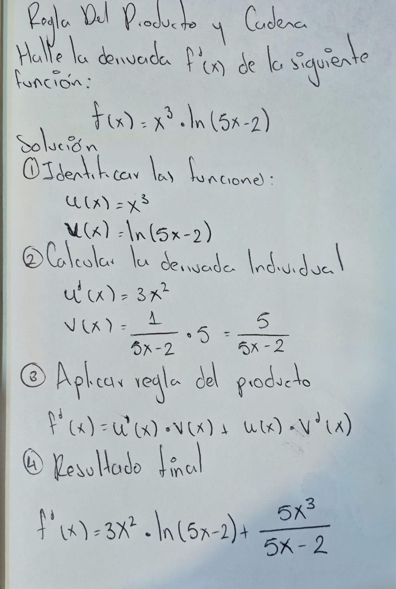
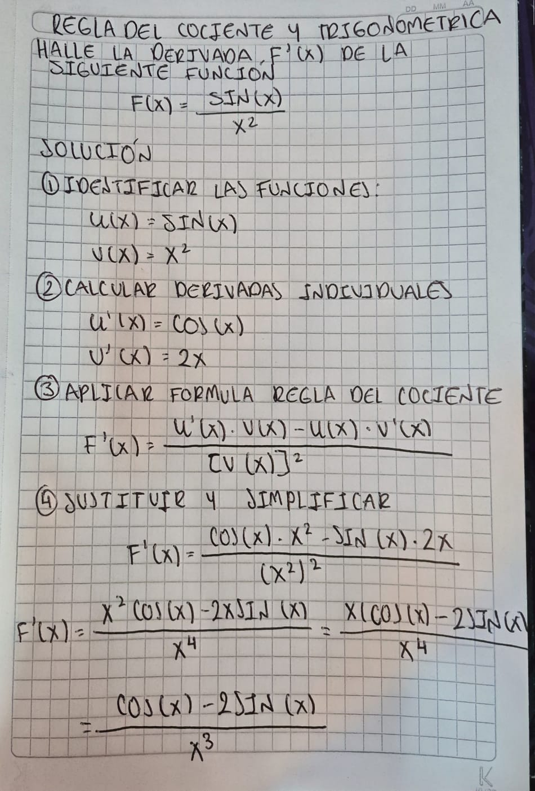

# 1.3 Varias imágenes en una solicitud

- **Fecha:** 2026-11-09 00:27
- **Modelo:** `qwen/qwen3.8-27b`
- **Imágenes enviadas:** 2

## Imágenes

**Imagen 1: `derivada_2.jpeg`**

**Imagen 2: `derivada_3.jpeg`**

## Pregunta

> Compara las dos imágenes de derivadas de forma muy concisa: 1) ¿Qué función se debe derivar en cada una?, 2) ¿Qué regla(s) de derivación requiere cada ejercicio?, 3) ¿Cuál es más compleja y por qué? Sé breve y directo en español.

## Respuesta del modelo

**1) Función a derivar**
- **Imagen 1:** f(x) = x³ · ln(5x − 2)
- **Imagen 2:** F(x) = sin(x) / x²

**2) Reglas requeridas**
- **Imagen 1:** Regla del **producto** + regla de la **cadena** (para derivar ln(5x−2)).
- **Imagen 2:** Regla del **cociente** + derivada **trigonométrica** (sin → cos). Sin regla de cadena.

**3) ¿Cuál es más compleja?**
La **Imagen 1** es más compleja: combina producto **y** cadena (el logaritmo de una función interna), lo que exige un paso extra de derivación encadenada. La Imagen 2 solo usa cociente con funciones directas (sin y potencia), sin composición interna.
